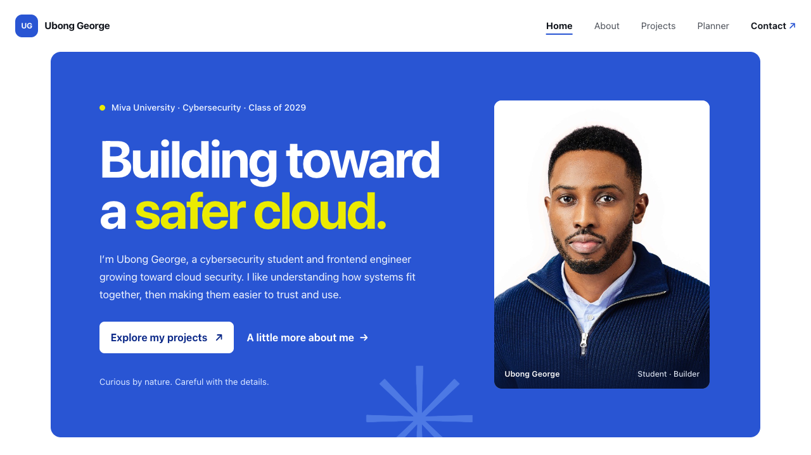

# Ubong George · Student Portfolio

**A responsive academic portfolio and student planner created for the Miva Open University web development assessment.**

[View the live website](https://uigeorge.github.io/miva-student-portfolio/) · [Browse the GitHub repository](https://github.com/uigeorge/miva-student-portfolio)

## Homepage



The homepage introduces me as a cybersecurity student and frontend engineer, shares my goal of becoming a Cloud Security Engineer, and connects visitors to my background, projects, and academic planner.

## Project overview

This multi-page website combines a personal portfolio with a small academic management tool. It is built with semantic HTML, an external responsive stylesheet, and vanilla JavaScript.

### Pages

- **Home** — introduction, portrait, selected projects, and a silent project video.
- **About** — education, career direction, technical skills, certifications, and interests.
- **Projects** — Expender, Next Foundry, and Tane. Tane is marked in progress; its public demo and source are not ready to share.
- **Academic planner** — add study tasks, set due dates, mark tasks complete, and delete tasks.
- **Contact** — name, email, phone, and message fields with JavaScript validation.

## Implementation notes

- **Responsive navigation:** the menu button in [`index.html`](index.html#L17) toggles the mobile navigation, updates its accessible label, and maintains `aria-expanded` in [`script.js`](script.js#L1).
- **Academic planner:** [`planner.html`](planner.html#L11) provides the task form. JavaScript validates and adds tasks, renders updates, handles completion and deletion, and saves the list in browser `localStorage` in [`script.js`](script.js#L112).
- **Contact form:** [`contact.html`](contact.html#L10) contains the four required fields. JavaScript checks empty fields, validates email format, and permits digits only in the phone field in [`script.js`](script.js#L177). A valid submission opens an email draft addressed to my Miva email; it does not send a message directly from the website.
- **Responsive layout and motion:** [`styles.css`](styles.css) uses CSS Grid and Flexbox, adapts at mobile breakpoints, provides interaction transitions, and honors `prefers-reduced-motion`.
- **Multimedia:** the homepage embeds a short silent video tour with a captions track in [`index.html`](index.html#L55).

## Assessment requirements

| Requirement | Where it is demonstrated |
| --- | --- |
| Student profile, photograph, welcome, and biography | [Home](index.html), [About](about.html) |
| Education, career aspiration, technical skills, and interests | [About](about.html) |
| Three project samples, descriptions, images, and links/status | [Projects](projects.html) |
| Add, complete, and delete planner tasks | [Planner](planner.html), [`script.js`](script.js#L112) |
| Contact fields and JavaScript validation | [Contact](contact.html), [`script.js`](script.js#L177) |
| Semantic HTML, forms, table, images, hyperlinks, and lists | Across the five pages |
| Multimedia | Silent video and captions on [Home](index.html) |
| External CSS, responsive layouts, navigation, and transitions | [`styles.css`](styles.css) |
| Event handling, DOM updates, arrays, and functions | [`script.js`](script.js) |

## Repository structure

```text
miva-student-portfolio/
├── .github/
│   └── workflows/
│       └── pages.yml
├── .gitignore
├── .stylelintrc.json
├── assets/
│   ├── badges/
│   │   ├── aws-certified-cloud-practitioner.png
│   │   ├── aws-certified-developer-associate.png
│   │   ├── aws-certified-solutions-architect-associate.png
│   │   ├── comptia-certified-network-plus.png
│   │   ├── comptia-certified-security-plus.png
│   │   └── hashicorp-certified-terraform-associate.png
│   ├── media/
│   │   ├── project-tour.mp4
│   │   └── project-tour.vtt
│   ├── projects/
│   │   ├── expender.png
│   │   ├── next-foundry.png
│   │   └── tane.png
│   ├── readme/
│   │   └── homepage-hero.png
│   ├── favicon.svg
│   └── portrait.jpeg
├── about.html
├── bun.lock
├── contact.html
├── DESIGN.md
├── index.html
├── package.json
├── planner.html
├── projects.html
├── README.md
├── script.js
└── styles.css
```

## Run locally

Open `index.html` directly or serve this folder with any static file server. The website has no build step or runtime dependencies. Stylelint and Prettier are development tools used to lint and format the stylesheet.

```sh
bun install
bun run format:css
bun run lint:css
```

## Hosting and data notes

The site is published with GitHub Pages. The workflow in `.github/workflows/pages.yml` deploys the repository root.

Planner entries are stored in the current browser and device and are not sent to a server. The contact form validates the fields and prepares an email draft; delivery depends on the visitor's configured email application.
